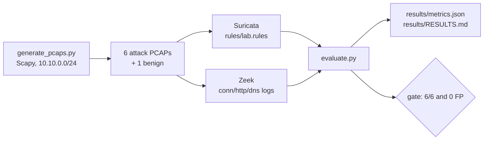

# network-detection-lab

[](https://github.com/youssefbouaouina/network-detection-lab/actions/workflows/ci.yml)
[](LICENSE)


Six network attack scenarios and one benign capture, generated locally as PCAPs, detected by a
hand-written Suricata ruleset and parsed by Zeek. The recall and false-positive numbers are
produced by `evaluate.py` from the real tool output.

## Why

Endpoint and Kubernetes detection are covered by my other labs. This one looks at the network
layer: what a small, well-understood ruleset catches, what it misses, and what Zeek's protocol
logs add when the IDS stays silent. Generating the captures keeps the licence clean and the
ground truth exact; the trade-off in realism is stated below.

## Method



- `expected.yaml` names the expected signature per scenario and zero alerts for the benign
  capture. It was committed before the first Suricata run.
- The rules are the only rule file loaded in CI (`suricata -S rules/lab.rules`), so a detection
  is attributable to this repository.
- Each scenario has its own PCAP, so alert counts are not mixed across scenarios.

| Scenario | Expected signature |
|---|---|
| 30 TCP SYN probes | `LAB TCP SYN scan` |
| HTTP `../` in the URI | `LAB HTTP path traversal` |
| HTTP boolean SQL injection | `LAB HTTP SQL injection` |
| `sqlmap` User-Agent | `LAB sqlmap user agent` |
| DNS query under `exfil.lab` | `LAB DNS exfiltration query` |
| 10 connections to port 22 | `LAB SSH brute force` |
| benign HTTP/DNS/SSH | none |

## Results

Run #2 of the CI workflow, 2026-11-05, from [`results/metrics.json`](results/metrics.json):

| Metric | Value |
|---|---|
| Scenarios detected | **6/6 (100%)** |
| Suricata alerts across malicious captures | 6 |
| Alerts on the benign capture | **0** |
| Zeek parsed (benign) | 6 connections, 3 HTTP requests, 2 DNS transactions |

| Scenario | Detected | Suricata alerts | Rule |
|---|---|---|---|
| 30 TCP SYN probes | yes | 1 | `LAB TCP SYN scan` |
| HTTP `../` in the URI | yes | 1 | `LAB HTTP path traversal` |
| HTTP boolean SQL injection | yes | 1 | `LAB HTTP SQL injection` |
| `sqlmap` User-Agent | yes | 1 | `LAB sqlmap user agent` |
| DNS query under `exfil.lab` | yes | 1 | `LAB DNS exfiltration query` |
| 10 connections to port 22 | yes | 1 | `LAB SSH brute force` |

The full per-capture alert log and Zeek `conn.log`/`http.log`/`dns.log` are committed under
`results/`, so every row above can be traced to a raw event. Suricata 7.0.3 and Zeek 9.0.1
are the versions recorded in `results/`.

The ruleset under test is the six rules in [`rules/lab.rules`](rules/lab.rules), not ET Open.
The reason is in **Limitations**: synthetic captures cannot fairly benchmark a community
ruleset, so the project measures its own rules instead of claiming a score for ET Open.

## Run

```bash
python -m venv .venv && . .venv/bin/activate
pip install -r requirements-dev.txt
python generate_pcaps.py
sudo apt install suricata zeek     # or use the CI workflow
bash scripts/run_lab.sh
```

The full run happens in `.github/workflows/ci.yml` on Ubuntu 24.04 with Suricata, Zeek and
Scapy installed from their pinned packages.

## Limitations

- The captures are synthetic. They are protocol-correct but small, so this measures rule logic,
  not performance on production traffic.
- Six rules and seven captures are a demonstration, not a benchmark of Suricata or Zeek.
- The rules are written after the scenarios by design (this is detection engineering); the
  ground truth was frozen before the first run so the *evaluation* is not fitted.
- TLS, SMB and encrypted C2 are out of scope.

## Sources and licence

See [`SOURCES.md`](SOURCES.md). Code and rules: MIT.

## Author

**Youssef Bouaouina** — [github.com/youssefbouaouina](https://github.com/youssefbouaouina) ·
[portfolio](https://youssefbouaouina.github.io/)
